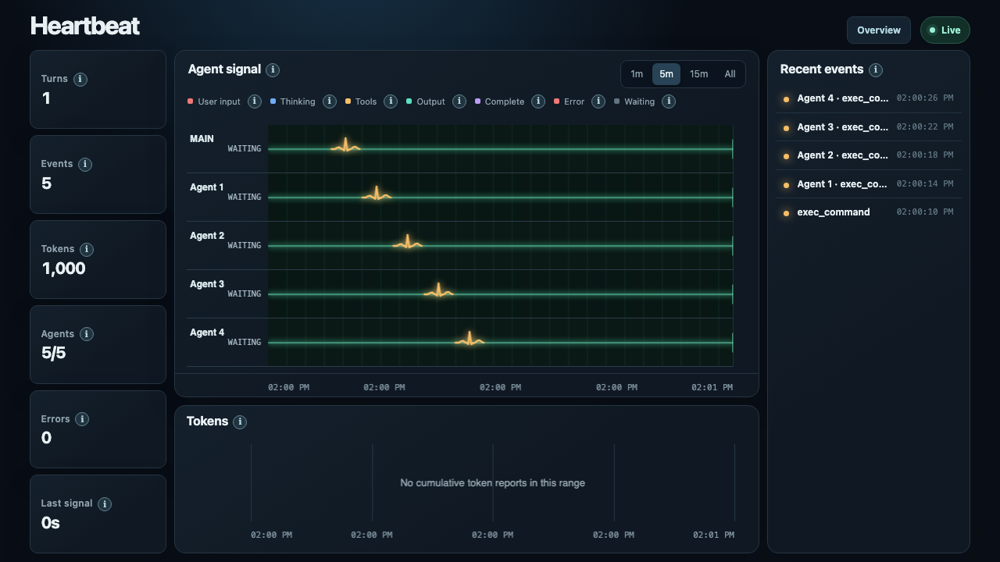
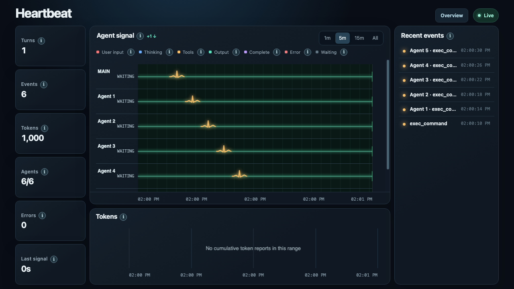

# Heartbeat

A local browser dashboard for Codex and Claude Code sessions. Heartbeat shows a signal for each active agent, recent tool activity, and cumulative token usage.

These screenshots use synthetic session data.



When more than five agents are active, scroll the signal panel to see the rest:



## Install

Requires Python 3.10 or newer.

```bash
git clone https://github.com/AhmedOmarO/heartbeat-monitor.git
cd heartbeat-monitor
python3 -m venv .venv
source .venv/bin/activate
python -m pip install -e .
```

## Use

```bash
heartbeat                    # latest Codex or Claude Code session
heartbeat --provider claude  # Claude Code only
heartbeat --provider codex   # Codex only
heartbeat <session-id>       # a specific session
```

The dashboard opens at `http://127.0.0.1:8765`. Choose 1m, 5m, 15m, or All to change the time range. The Memory page lets you read project Markdown files and edit `MEMORY.md`.

Heartbeat reads local session files under `~/.codex` and `~/.claude` (or the configured home directories). It does not upload session data. Claude Code transcripts do not contain the Codex usage-limit windows, so their limit card is hidden.
